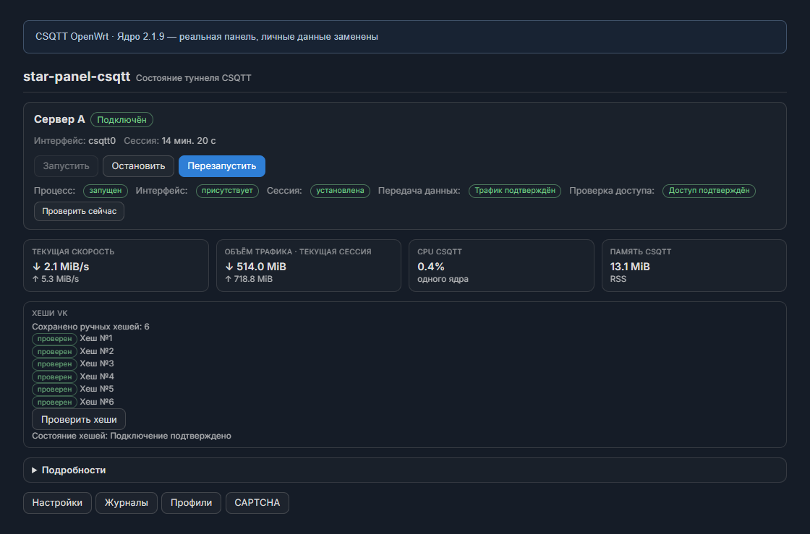
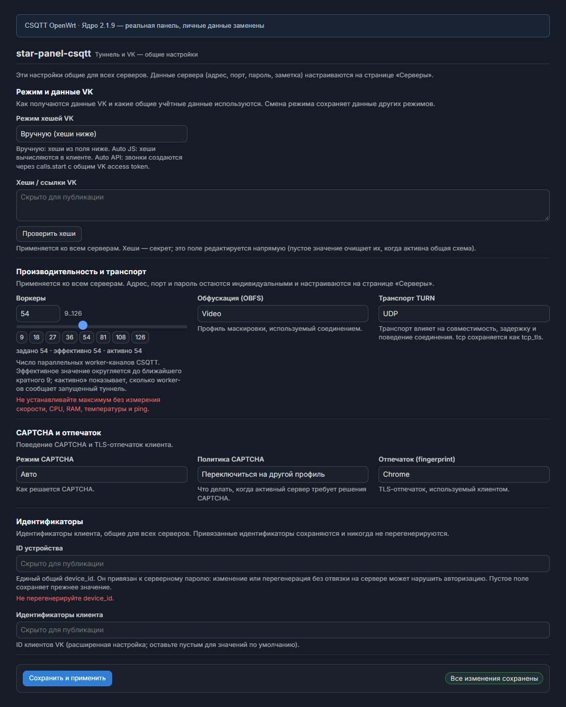
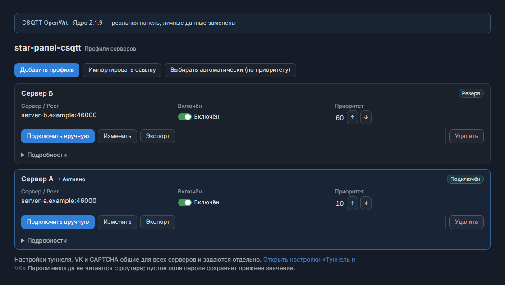
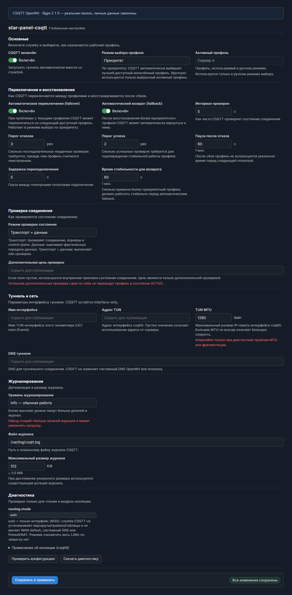

# CSQTT OpenWrt (Fork)

> [!NOTE]
> **Это форк проекта [starkugz/csqtt-openwrt](https://github.com/starkugz/csqtt-openwrt).**  
> **Ключевые доработки в форке:**
> * Поддержка нового формата ссылок `csqtt://` из ядра **CSQTT v2.5.0+** ([amurcanov/csqtt](https://github.com/amurcanov/csqtt)) с шифрованием AES-256-GCM (`csqtt-chiper-key`).
> * Обратная совместимость с открытыми ссылками v2 (`connect?v=2...`) и legacy-ссылками.
> * В репозиторий добавлены открытые исходники пакета панели `luci-app-csqtt` (JS-контроллеры, ucode rpcd-модуль, ACL).
> * Требования **Hardening**: все временные файлы, сокеты, vk_pool и логи изолированы в RAM (`/var/run/csqtt/` и `/tmp/`), исключая износ NAND-флеш роутера.

**CSQTT** подключает роутер на OpenWrt к серверу CSQTT и позволяет управлять подключением
через веб-интерфейс LuCI на русском языке.

Чтобы пользоваться туннелем, нужны **два условия**:

1. **данные сервера CSQTT** — ссылка подключения `csqtt://…` (адрес сервера и пароль);
2. **направление трафика** — отдельный прокси-клиент, привязанный к интерфейсу `csqtt0`.

Сама по себе установка CSQTT **не переводит** весь интернет домашних устройств в туннель:
CSQTT поднимает интерфейс `csqtt0` и не меняет маршруты, системный DNS, firewall и NAT
(подробнее — [сетевой контракт](docs/network-contract.md)).

**Коротко о главном:**

- Уже есть ссылка подключения — [установка на роутер](#установка-на-роутер).
- Нужен собственный сервер — [инструкция для VPS](docs/server.md).
- Готовые команды для копирования — [быстрые команды](#быстрые-команды-установка-и-удаление).

**Оригинальный проект:** [starkugz/csqtt-openwrt](https://github.com/starkugz/csqtt-openwrt) · **Апстрим ядра CSQTT:** [amurcanov/csqtt](https://github.com/amurcanov/csqtt)

<details>
<summary><strong>Скриншоты панели</strong></summary>



> Реальная панель LuCI. Личные данные скрыты, названия и адреса серверов
> демонстрационные. Снимки сделаны до выпуска v1.0 (см. [описание](screenshots/README.md)).

<details>
<summary>Ещё скриншоты: Туннель и VK, Профили, Настройки</summary>

### Туннель и VK

Общие настройки авторизации, воркеров и транспорта. Секреты и идентификаторы
скрыты.



### Профили

Выбор сервера и приоритеты. Названия и адреса серверов вымышленные.



### Настройки

Управление службой, восстановлением соединения и диагностикой.



</details>

</details>

## Быстрые команды: установка и удаление

Короткие команды для копирования. Подробное описание — в разделах
[«Установка на роутер»](#установка-на-роутер), [«Удаление»](#удаление) и в документе
[«Свой сервер на VPS»](docs/server.md).

### На роутере по SSH

**Установка или обновление клиента и панели** (обновление — той же командой). Скрипт
сначала скачивается целиком и запускается только после успешной загрузки, затем служба
перезапускается:

```sh
wget --no-proxy -qO /tmp/csqtt-install.sh https://raw.githubusercontent.com/starkugz/csqtt-openwrt/main/install-csqtt.sh \
  && ash /tmp/csqtt-install.sh && /etc/init.d/csqtt restart
```

> Настройки, профили, пароли, токены, VK-хеши и `device_id` **сохраняются**. Скрипт
> проверяет контрольные суммы SHA-256, делает сухой прогон зависимостей и резервную копию
> конфигурации.

**Удаление клиента и панели:**

```sh
wget --no-proxy -qO /tmp/csqtt-uninstall.sh https://raw.githubusercontent.com/starkugz/csqtt-openwrt/main/uninstall-csqtt.sh \
  && ash /tmp/csqtt-uninstall.sh
```

> Настройки и профили (`/etc/config/csqtt`) **сохраняются** — их можно использовать при
> повторной установке. Отдельного режима «удалить вместе с настройками» нет: ненужные
> настройки удаляются вручную (`rm -f /etc/config/csqtt`).

### На VPS по SSH

Серверную часть ставит и удаляет один и тот же установщик. Его файлы — `install-server.sh`,
запускаемый им `server/serverctl.py` и зафиксированный `server/source-lock.json` — скачивает
**загрузчик** `install-server-online.sh`: он проверяет, что есть `curl` (или `wget`) и
`python3`, кладёт файлы в созданный им временный каталог, запускает штатный установщик с
переданными аргументами и убирает за собой. Порядок шагов, вопросы установщика и ограничения
описаны в документе [«Свой сервер на VPS»](docs/server.md).

**Установка серверной части** (`--work-dir` — рабочий каталог установщика):

```sh
curl -fsSLo /tmp/csqtt-server.sh https://raw.githubusercontent.com/starkugz/csqtt-openwrt/main/install-server-online.sh \
  && sh /tmp/csqtt-server.sh --work-dir /root/csqtt-server-work/setup
```

> Установщик задаёт вопросы (порты, `device_id`, подтверждение) и **создаёт новые** данные
> доступа: адрес панели, логин, пароли и `device_id`; они сохраняются в рабочем каталоге
> `/root/csqtt-server-work/setup`. Повторный запуск при уже установленном сервере сообщит об
> этом и ничего не изменит.

**Удаление серверной части** — тот же загрузчик, режим `uninstall` установщика:

```sh
curl -fsSLo /tmp/csqtt-server.sh https://raw.githubusercontent.com/starkugz/csqtt-openwrt/main/install-server-online.sh \
  && sh /tmp/csqtt-server.sh uninstall --work-dir /root/csqtt-server-work/setup
```

> Туннель и веб-панель останавливаются и удаляются, а **настройки сервера (`/etc/csqtt`),
> база, сертификаты и данные доступа сохраняются** — для них создаётся защищённая резервная
> копия. Безвозвратное удаление данных — только по явному `--purge` (с подтверждением):
> см. [«Свой сервер на VPS»](docs/server.md#повторная-установка-и-удаление-данных).

## Что такое CSQTT для OpenWrt

CSQTT — это клиент туннеля для OpenWrt. На роутере он:

- поднимает сетевой интерфейс `csqtt0` и поддерживает соединение с сервером CSQTT;
- показывает состояние и настройки на страницах панели LuCI: **«Статус»**, **«Туннель и VK»**,
  **«Профили»**, **«Настройки»**, **«Журналы»**, **«CAPTCHA»**, **«О программе»**.

Что важно понимать сразу:

- **Туннель не заработает «в один клик».** Нужны данные сервера и настроенное направление
  трафика в `csqtt0`.
- **Стабильность, скорость и совместимость не гарантируются.** Они зависят от провайдера,
  сервера и настроек; проект не обещает бесперебойную работу.
- CSQTT **не является средством обхода законодательства**.
- Трафик в туннель направляет **отдельный прокси-клиент**, а не CSQTT (см.
  [совместимость с прокси-клиентами](#совместимость-с-прокси-клиентами)).

CSQTT умеет хранить **несколько сохранённых серверов** и переключаться на резервный сервер
при сбое, а затем возвращаться обратно. Полный список возможностей и подробные настройки —
в документе [«Расширенные настройки»](docs/advanced.md).

При включённом автозапуске CSQTT после загрузки роутера ожидает готовности внешнего подключения — появления интерфейса, IP-адреса и маршрута — и затем начинает подключение к серверу. Это относится как к кабельному WAN, так и к модему. Пока необходимых условий нет, панель показывает «Ожидание сети». Доступность обычных сайтов напрямую не является условием запуска туннеля.

## Что понадобится и как проверить совместимость роутера

Понадобится:

- **Роутер на OpenWrt** поддерживаемого выпуска и архитектуры (см. ниже).
- **Доступ по SSH** к роутеру (логин `root`).
- **Данные сервера:** ссылка подключения `csqtt://…` — её выдаёт владелец сервера. Если
  своего сервера нет — [инструкция для VPS](docs/server.md).
- **Данные авторизации** для выбранного режима: обычно достаточно ссылки с VK-хешами; для
  режимов на основе токена понадобится **токен доступа VK** (см.
  [«Расширенные настройки»](docs/advanced.md)).
- **Совместимый прокси-клиент** — он направляет трафик в `csqtt0`: **Mihomo**, **SSClash**,
  **Podkop**, **Forkop** или **ZeroBlock** (см.
  [совместимость с прокси-клиентами](#совместимость-с-прокси-клиентами)).
- **Доступ в интернет** на роутере — для установки зависимостей из репозитория OpenWrt.

Узнать выпуск и архитектуру вашего роутера можно командой **на роутере**:

```sh
cat /etc/openwrt_release   # нужны строки DISTRIB_RELEASE и DISTRIB_ARCH
```

### Поддерживаемые OpenWrt и архитектуры

| Выпуск OpenWrt | Формат / менеджер | Архитектуры (`DISTRIB_ARCH`) |
|---|---|---|
| **24.10.x** | opkg / `.ipk` | `aarch64_cortex-a53`, `x86_64`, `aarch64_generic`, `arm_cortex-a7_neon-vfpv4` |
| **25.12.x** | apk / `.apk` | те же четыре |
| **SNAPSHOT** | apk / `.apk` | `aarch64_cortex-a53` |

Минимальные требования к памяти и список проверенных моделей роутеров **не заявляются**.
Подробности — в документе [«Сборка, версии и проверки»](docs/build.md).

## Установка на роутер

Все команды этого раздела выполняются **на роутере** по SSH.

Понадобятся **два пакета** — ядро и панель. Проще всего поставить их скриптом: готовая
команда для копирования — в разделе
[«Быстрые команды»](#быстрые-команды-установка-и-удаление) (установка и обновление — одна и
та же команда).

Команда сначала скачивает скрипт во временный файл и запускает его **только если скачивание
удалось** (`wget … && ash …`): при обрыве связи `wget` вернёт ошибку, и `ash` не запустится
— простая форма `… | ash` этого не гарантирует (см. [«Установка на роутер»](docs/install.md)).

После замены пакетов команда перезапускает службу (`/etc/init.d/csqtt restart`): менеджер
пакетов **не перезапускает** уже работающий процесс, и без этого продолжило бы работать
прежнее ядро, оставшееся в памяти. Перезапуск выполняется только при успешной установке.

Скрипт сам определит выпуск и архитектуру, скачает ядро и панель по манифесту, проверит
контрольные суммы SHA-256, сделает сухой прогон зависимостей, сохранит резервную копию
конфигурации и установит пакеты. Существующие настройки, токены и `device_id` при
обновлении **не заменяются**.

- Ручная установка, варианты скрипта и контрольные суммы — в документе
  [«Установка на роутер»](docs/install.md).
- Обновление — [ниже](#обновление).
- Если что-то не работает — [что делать](#что-делать-если-не-работает).

## Первое подключение

1. **Откройте панель.** В LuCI зайдите в **Службы → star-panel-csqtt**.
2. **Добавьте сервер.** Откройте **«Профили» → «Импортировать ссылку»** (или
   **«Добавить профиль»**) и укажите **«Сервер»** и **«Пароль»** из ссылки подключения. Если
   ссылка содержит VK-хеши, при импорте можно отметить **«VK-хеши → в общие»**.
3. **Настройте авторизацию VK,** если в ссылке нет хешей. Откройте **«Туннель и VK»** и
   задайте **«Режим авторизации VK»**, **«Получение хешей VK»** и **«Токен доступа VK»**
   (подробно — [«Расширенные настройки»](docs/advanced.md)).
4. **Включите подключение.** Включите тумблер **«Профиль включён»**, а на странице
   **«Настройки»** — **«CSQTT включён»**. При необходимости на странице **«Статус»**
   нажмите **«Запустить»**.
5. **Направьте трафик в `csqtt0`** — см.
   [совместимость с прокси-клиентами](#совместимость-с-прокси-клиентами).
6. **Проверьте результат** — см. [как проверить](#как-проверить-что-всё-работает).

Описание всех страниц и элементов панели — в документе [«Панель LuCI»](docs/luci.md).

## Совместимость с прокси-клиентами

CSQTT создаёт интерфейс **`csqtt0`**, но сам трафик в туннель не направляет. Направляет его
**прокси-клиент**, который умеет привязывать исходящие соединения к интерфейсу. Какие сайты и
приложения попадут в туннель, решают **правила клиента**, а не CSQTT.

Клиенты, которые так умеют (точные названия): **Mihomo**, **SSClash** (`luci-app-ssclash`),
**Podkop**, **Forkop**, **ZeroBlock**.

- **Mihomo** и **SSClash** (ядро mihomo) сами по себе маршруты, системный DNS и firewall не
  меняют: выход настраивается полем `interface-name: csqtt0`. Но их **собственный** конфиг
  может менять маршрутизацию и DNS (перехват DNS, FakeIP, свои правила) — тогда `csqtt0`
  получает трафик уже по правилам клиента. Контракт **CSQTT** (interface-only: только
  `csqtt0`, без правки WAN, маршрутов, системного DNS и firewall) относится к CSQTT, а не к
  настройкам клиента: за то, что попадёт в `csqtt0`, отвечает именно конфиг Mihomo/SSClash.
- **Podkop**, **Forkop** и **ZeroBlock** тоже умеют выходить через `csqtt0`, но перехватывают
  системный DNS и конфликтуют между собой — их настраивают осторожно и по одному.

Умение клиента выбирать исходящий интерфейс **не означает** полной совместимости любых его
версий: набор настроек и поведение отличаются. Способ настройки зависит от клиента.

### Пример для Mihomo

`csqtt0` уже создан CSQTT — второй TUN или сетевой интерфейс в OpenWrt создавать **не нужно**.
Достаточно добавить в конфигурацию Mihomo **отдельный выход** и направить на него правила.

```yaml
# в существующую секцию proxies — добавить элемент:
proxies:
  - name: CSQTT
    type: direct
    interface-name: csqtt0
```

```yaml
# в существующую секцию proxy-groups — добавить группу выбора
# (или дописать CSQTT в уже имеющуюся группу):
proxy-groups:
  - name: CSQTT-Select
    type: select
    proxies:
      - CSQTT
      - DIRECT
```

```yaml
# в существующую секцию rules — порядок важен: срабатывает ПЕРВОЕ подходящее
# правило, поэтому свои правила добавляйте ВЫШЕ уже имеющегося MATCH.
rules:
  - IP-CIDR,203.0.113.10/32,DIRECT,no-resolve   # адрес вашего сервера (пример) — напрямую
  - DOMAIN-SUFFIX,example.com,CSQTT-Select      # выбранный трафик — в туннель
  # ... ваши прежние правила ...
  - MATCH,DIRECT                                # существующее завершающее правило — НЕ трогайте
```

- **Не заменяйте** завершающее правило (`MATCH,...`) на `MATCH,DIRECT` и не удаляйте его:
  новое правило `MATCH` в конце недостижимо. Просто **добавьте свои правила выше** него.
- **Не создавайте вторые секции** `proxies`, `proxy-groups` и `rules`: Mihomo отклоняет
  конфигурацию с повторяющейся корневой секцией.
- Исключение для адреса сервера CSQTT поставьте **выше** правил, ведущих в туннель, — иначе
  служебные соединения CSQTT уйдут в туннель и получится петля.
- **Одного исключения адреса сервера недостаточно.** Служебные соединения CSQTT идут не только
  к вашему серверу, но и к адресам **VK и TURN** (control-plane: получение данных подключения,
  проверка, работа через TURN). Эти адреса заранее неизвестны и меняются, поэтому
  универсального «списка исключений» не существует: сохраняйте им **прямой доступ** теми
  правилами, которые уже есть у вас (например, отдельная группа/правило `DIRECT` для
  VK-доменов и адресов TURN) — либо настройте клиент так, чтобы его общее правило по умолчанию
  не заворачивало всё подряд в `csqtt0`. Если control-plane CSQTT уйдёт в `csqtt0`, подключение
  зациклится.
- **Не задавайте глобальный `interface-name`** у Mihomo: он привяжет к `csqtt0` весь трафик
  Mihomo. Для CSQTT нужен только отдельный выход.
- Выберите выход `CSQTT` в группе и проверьте **реальный запрос**: появление выхода в списке
  само по себе ничего не доказывает.

Конфигурация проверена штатным валидатором ядра Mihomo, но **передача трафика через туннель
на реальном роутере не проверялась**. Подробную инструкцию (термины, куда вставлять
фрагменты, порядок правил, проверку запроса, поведение панелей, пересобирающих конфиг, и
статус проверок) см. в документе
[«Совместимость с прокси-клиентами»](docs/compatibility.md).

## Как проверить, что всё работает

Проверяйте по порядку: это **три разных состояния**, и они не заменяют друг друга.

| Что проверяем | Как | Ожидаемый результат |
|---|---|---|
| **Служба запущена** | на роутере: `csqtt status` или страница «Статус» | процесс идёт (это не то же самое, что автозапуск) |
| **Соединение установлено** | на роутере: `csqtt status`; страница «Статус» | состояние «подключён», интерфейс `csqtt0` поднят |
| **Трафик действительно идёт** | на роутере: пробный запрос через интерфейс | внешний IP — это IP сервера CSQTT |
| **Проверка доступа пройдена** | страница «Статус» (активная проверка) | цель доступна *через* `csqtt0`; если проверка «не применима» — это не «успех» и не доказательство неисправности туннеля |

**Запуск службы и автозапуск — разные состояния.** Процесс может идти без автозапуска (после
перезагрузки не поднимется) и наоборот. Снимается/ставится автозапуск командой
`/etc/init.d/csqtt enable|disable` (в панели — переключатель «CSQTT включён»).

Пробный запрос **на роутере**:

```sh
curl --interface csqtt0 --max-time 15 https://1.1.1.1/cdn-cgi/trace
```

В ответе найдите строку `ip=`. Если там **IP вашего сервера CSQTT**, а не ваш обычный
внешний IP, — трафик действительно идёт через туннель.

Запущенная служба и установленное соединение **сами по себе не доказывают**, что трафик
идёт: нужен реальный запрос через `csqtt0`. И наоборот, ответ внешнего сайта сам по себе
ничего не доказывает, если запрос ушёл мимо интерфейса.

Дополнительно **на роутере**:

```sh
csqtt doctor             # read-only диагностика (конфиг, TUN, peer, rp_filter)
ip -4 addr show csqtt0   # адрес интерфейса
```

Если что-то не работает — [что делать](#что-делать-если-не-работает).

## Обновление

Обновление — это установка новых пакетов из нового выпуска. Настройки, профили, токены,
VK-хеши, пароли и `device_id` **сохраняются**. На время обновления и перезапуска службы
подключение может кратко прерваться.

Проще всего обновиться тем же скриптом, что и при установке — **той же командой**
(см. [«Быстрые команды»](#быстрые-команды-установка-и-удаление)); отдельного «режима
обновления» нет.
Скрипт сохранит конфигурацию и при ошибке не удалит установленные пакеты.

Отдельно можно обновить **только ядро**, сохранив панель и настройки. **На роутере:**

```sh
wget --no-proxy -qO /tmp/csqtt-install.sh https://raw.githubusercontent.com/starkugz/csqtt-openwrt/main/install-csqtt.sh \
  && ash /tmp/csqtt-install.sh --core-only && /etc/init.d/csqtt restart
```

Скрипт запускается **только после успешного скачивания** (`wget … && ash …`): при обрыве
связи неполный файл не выполнится, и «только ядро» не оставит систему в половинчатом
состоянии.

Команда обновления, как и команда установки, перезапускает службу **после успешной** замены
пакетов: уже работающий процесс держит в памяти прежний бинарник, поэтому без перезапуска
обновление не вступило бы в силу.

Ручное обновление пакетами, режим «только ядро» и откат версии — в документе
[«Обновление и удаление»](docs/update.md).

## Удаление

Удаление убирает CSQTT и его панель с роутера, останавливает службу и снимает автозапуск.
**Настройки сохраняются** — их можно использовать при повторной установке. Команда
выполняется **на роутере** и приведена в разделе
[«Быстрые команды»](#быстрые-команды-установка-и-удаление).

Скрипт останавливает службу, удаляет ядро и панель (и старый пакет перевода, если он остался
от прошлых выпусков) и никогда не называет чужие пакеты. При этом **apk** (OpenWrt 25.12+)
может дополнительно убрать автоматически установленные зависимости, которые стали никому не
нужны; зависимости, установленные в системе явно или нужные другим пакетам и базовой системе,
остаются. **opkg** (24.10) зависимости не трогает. Конфигурацию и профили он
перед удалением копирует в защищённый временный каталог и восстанавливает, если менеджер
пакетов их снёс. Маршрутизация, DNS и firewall не изменяются.

Не забудьте убрать привязку `csqtt0` в вашем прокси-клиенте — иначе его соединения останутся
без интерфейса.

У скрипта **один режим удаления**: он всегда сохраняет настройки. Если настройки и профили
больше не нужны, удалите их вручную **на роутере**:

```sh
rm -f /etc/config/csqtt            # конфигурация и профили
rm -f /etc/config/csqtt.bak.*      # копии, которые оставлял установщик (если есть)
```

Ручное удаление теми же шагами — в документе
[«Обновление и удаление»](docs/update.md#удаление).

## Что делать, если не работает

Начните с диагностики **на роутере**:

```sh
csqtt doctor
csqtt log tail -n 50
```

Частые случаи:

- **Служба не запущена** — включите **«CSQTT включён»** на странице «Настройки».
- **Профиль выключен** — включите тумблер **«Профиль включён»** на странице «Профили».
- **Соединение есть, а трафика нет** — прокси-клиент не привязан к `csqtt0` (см.
  [совместимость с прокси-клиентами](#совместимость-с-прокси-клиентами)).
- **Нет интерфейса `csqtt0`** — служба не запущена либо не загружен модуль TUN.
- **Ошибки авторизации VK** — проверьте **«Токен доступа VK»** и выбранный режим.

Полный список симптомов, причин и безопасных проверок — в документе
[«Диагностика и восстановление»](docs/troubleshooting.md).

## Подробные инструкции, авторство и лицензия

**Подробные инструкции:**

- [Свой сервер на VPS](docs/server.md) — установка, повторная установка и удаление серверной
  части.
- [Установка на роутер](docs/install.md) — ручная установка, таблицы загрузок, варианты
  скрипта, контрольные суммы.
- [Панель LuCI](docs/luci.md) — назначение страниц и элементов, выбор сервера и
  [расширенные настройки](docs/advanced.md) (режимы VK, воркеры, обфускация, транспорт,
  проверка подключения, команды).
- [Обновление и удаление](docs/update.md) — обновление, режим «только ядро», полное удаление.
- [Диагностика и восстановление](docs/troubleshooting.md) — типовые проблемы и безопасная
  диагностика.
- [Совместимость с прокси-клиентами](docs/compatibility.md) — Mihomo, SSClash, Podkop,
  Forkop, ZeroBlock: как настроить выход через `csqtt0`, что проверено и каков
  [сетевой контракт](docs/network-contract.md) CSQTT.

**Актуальный выпуск:** [github.com/starkugz/csqtt-openwrt/releases/latest](https://github.com/starkugz/csqtt-openwrt/releases/latest).

**Авторство и лицензия.** Исходное ядро CSQTT и
[исходный проект](https://github.com/amurcanov/csqtt) созданы
**[amurcanov](https://github.com/amurcanov)** (и соавторами, см. [NOTICE.md](NOTICE.md));
редакция **CSQTT OpenWrt** добавляет интеграцию в OpenWrt и панель LuCI с русским
интерфейсом и не выдаёт исходное ядро за собственную разработку. Изменения редакции
распространяются на тех же условиях. Лицензия — PolyForm Noncommercial License 1.0.0
([полный текст](LICENSE)), только некоммерческое использование.

> Required Notice: Copyright 2026 amurcanov
